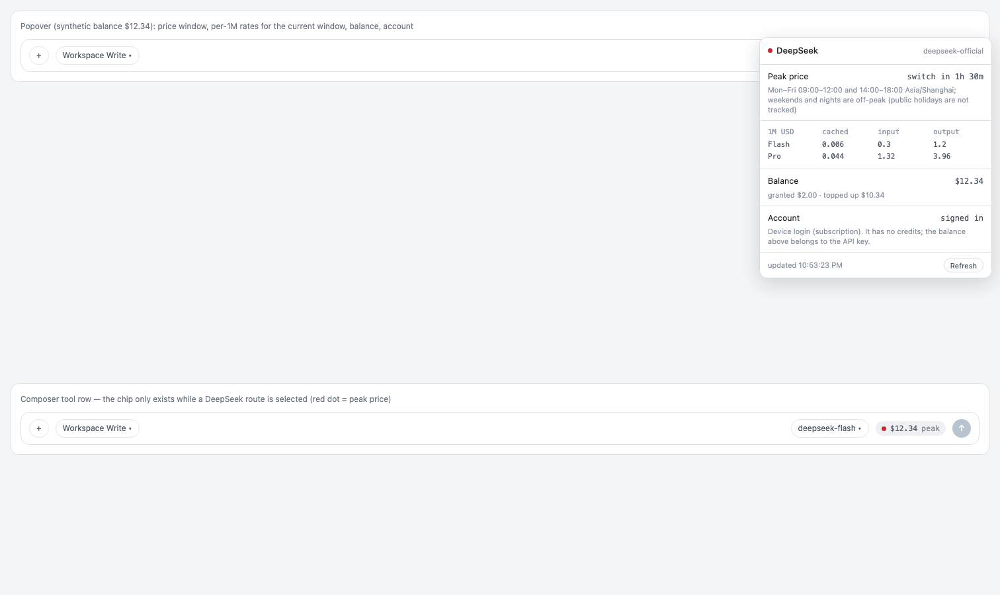

# dsh-plugin-deepseek-clock — DeepSeek price clock and balance for DeepSeek Harness

A contextual meter in the composer tool row, next to the model selector. It is
rendered **only while the session's selected provider is a DeepSeek route**
(`deepseek-official`, `deepseek-account`, …); with any other provider the row is
untouched.



The chip shows a price dot and the API balance:

- **dot** — green = off-peak (half price), red = peak;
- **text** — the balance: `$12.34` from the API key, or `$14.46` from the
  signed-in account's Platform wallets; `login` when the account is signed in but
  its wallets cannot be read; `no key` when neither route is available.

The popover adds the window schedule, the next switch, the per-1M rates of the
current window, the topped-up/granted balance and the account state.

## Three facts, three sources

| Fact | Source |
|---|---|
| **price window** | computed locally — no network |
| **balance** | `GET https://api.deepseek.com/user/balance` with `DEEPSEEK_API_KEY` |
| **account** | the `deepseek-account-platform/*` grant record, and its Platform wallets |

### Price window

DeepSeek bills half price outside peak hours. Peak is **Beijing time (UTC+8),
Monday–Friday 09:00–12:00 and 14:00–18:00**; everything else — nights, weekends —
is off-peak ([official pricing page](https://api-docs.deepseek.com/zh-cn/quick_start/pricing)).
Chinese public holidays are off-peak too, but they are not tracked here, so a
holiday Monday reads as peak.

The popover lists the published rates for the current window (CNY per 1M tokens,
USD when the balance is in USD):

| per 1M | cached | input | output |
|---|---|---|---|
| Flash (off-peak / peak) | 0.02 / 0.04 | 1 / 2 | 4 / 8 CNY |
| Pro (off-peak / peak) | 0.15 / 0.30 | 4.5 / 9 | 13.5 / 27 CNY |

### Balance

Two routes, two sources, one number on the chip:

**API key** — `DEEPSEEK_API_KEY` is resolved the way DSH resolves provider keys:
`ctx.credentials` first, then the environment, then the `refs` block of
`$DSH_HOME/.credentials.yaml`. `GET https://api.deepseek.com/user/balance` returns
`{is_available, balance_infos:[{currency, total_balance, granted_balance,
topped_up_balance}]}`.

**Account (device login)** — the stored grant in
`deepseek-account-platform/default` (a token plus its issuer) is sent as
`x-dsh-auth-token` to `GET https://platform.deepseek.com/api/v0/users/get_user_summary`
— the very call the app's own Settings card uses. The payload is wrapped twice:
`data.biz_data.normal_wallets` is the topped-up balance and `bonus_wallets` the
granted one, both `{currency, balance}` string pairs. The token never leaves the
host process, and the request is only made when the grant's issuer matches the
configured `platformOrigin`.

The API key wins when both exist. Readings are cached for a minute, and a failed
refresh keeps the last good value marked `stale`. With neither route the chip says
`no key`; a signed-in account whose wallets cannot be read says `login`.

### Account

The login state is read from the credential records
(`deepseek-account-platform/default`, `…/device`): their presence means the
device login is stored. Nothing is requested from the network for this.

## Route

```
GET /api/deepseek/meter[?refresh=1]
→ { ok, price, account, api, rates, fetchedAt }
```

`apiBase` (default `https://api.deepseek.com`) can be overridden in the row config.

## Install

DSH Desktop: **Settings → Plugins → add plugin**, type the package name. From the
CLI: `dsh plugin --profile <your-profile> add <name>`, then restart the harness.

```
name: dsh-plugin-deepseek-clock
```

## Checks

```sh
node test/smoke.mjs     # price windows at fixed instants, balance route, account detection, chip visibility
node test/preview.mjs   # renders the chip + popover for a screenshot
```

The smoke test pins the clock (2026-10-26 is a Monday) and asserts the window
boundaries in Beijing time, the balance normalisation, the one-minute cache, the
stale fallback, the no-key case, and that the chip renders nothing for a
non-DeepSeek provider.

## Client-runtime notes (found the hard way)

Two details of the client plugin API are easy to get wrong; both make the chip
silently disappear:

1. **`inject` receives the session id (a string), not a props object.** The slot
   hands it the id itself, so `inject: ({ sessionId }) => …` destructures a string
   and yields `undefined`.
2. **Register the surface inside `ctx.inject(["slots", "modelDirectories"], scope
   => …)` and declare `remote.session` in `inject`.** Resolving a session's model
   directory reaches the session scope's wire face; without the dotted service
   name every `directoryFor()` call throws
   `cannot get property "remote.session" without inject`, which a try/catch turns
   into "no provider ⇒ render nothing".

The directory is read through `directory.store` (`SnapshotStore`:
`subscribe`/`getSnapshot`), the same object the composer's model seat uses.

## Limits

- Public holidays are not modelled.
- One balance currency is shown on the chip; the popover shows the first entry the
  API reports.
- The account route reads the Platform wallets, not a spend history: per-request
  costs stay in the Platform's "View usage" page.
